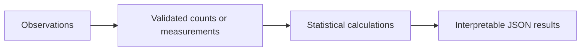

# Sleep and Activity Descriptive Statistics

**Feras Elghandour** · Technical case study

Summarize variation in activity, daily steps, and heart rate with explicit distinctions between sample and population standard deviations.

## Implementation

A CSV-to-JSON statistics command with linear-interpolated quartiles, modes, IQR fences, and outlier counts. The historical aggregate study is included separately from the executable implementation.



## Results

The retained study summarizes 374 observations. Daily steps average 6,816.84 (median 7,000); physical activity averages 59.17. Heart rate has sample SD 4.1357 and population SD 4.1301, with 15 observations above the upper IQR fence of 78.

The retained aggregates are in [results/aggregate_counts.json](results/aggregate_counts.json). The Python implementation is an improved reusable version of the calculations; historical aggregates and fresh behavior tests have separate scopes.

## Reproduce

Python 3.11 or later; no third-party packages are required.

```sh
python describe.py /path/to/observations.csv
python -m unittest discover -s tests -v
```

## Practical relevance and limits

Descriptive outliers are not diagnoses. The observational sample is not evidence of a causal relationship between activity and sleep quality or representative population norms.

Raw observations and classroom slide materials are not included. For new analyses, provide your own authorized counts or CSV. No client deployment or commercial result is claimed.
