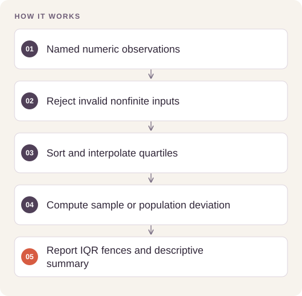

# Sleep and Activity Descriptive Statistics

Summarize variation in activity, daily steps, and heart rate with explicit distinctions between sample and population standard deviations.

## Implementation

A CSV-to-JSON statistics command with linear-interpolated quartiles, modes, IQR fences, and outlier counts. The historical aggregate study is included separately from the executable implementation.




## Reproduce and inspect

The executable reproduction profile now records exact commands, input/source hashes, dependency versions, logs and pass/fail status. Its scope distinguishes behavior checks from full-data benchmarks.

[Commands, artifacts and benchmark scope](BENCHMARKS.md) · [Versioned profiles](reproduction.json)


## Try a small example

A small offline fixture exercises the public implementation. It demonstrates the behavior shown below; it does not replace the historical dataset, benchmark or production validation.

After the local setup below, run from the repository root:

```sh
python examples/quickstart.py
```

The [example source](examples/quickstart.py), [captured output](examples/expected-output.txt) and [execution record](examples/environment.json) keep this demonstration inspectable. Floating-point values may vary with library versions.

Observed output from this run:

```text
{
  "n": 4,
  "mean": 2.5,
  "median": 2.5,
  "modes": [
    1.0,
    2.0,
    3.0,
    4.0
  ],
  "sample_sd": 1.2909944487358056,
  "population_sd": 1.118033988749895,
  "min": 1.0,
  "max": 4.0,
  "q1": 1.75,
  "q3": 3.25,
  "iqr": 1.5,
  "outlier_fences": [
    -0.5,
    5.5
  ],
  "outlier_count": 0
}
```

## Results

The retained study summarizes 374 observations. Daily steps average 6,816.84 (median 7,000); physical activity averages 59.17. Heart rate has sample SD 4.1357 and population SD 4.1301, with 15 observations above the upper IQR fence of 78.

The retained aggregates are in [results/aggregate_counts.json](results/aggregate_counts.json). The Python implementation is an improved reusable version of the calculations; historical aggregates and fresh behavior tests have separate scopes.

## Reproduce

Python 3.11 or later; no third-party packages are required.

```sh
python describe.py /path/to/observations.csv
python -m unittest discover -s tests -v
```

## Practical relevance and limits

Descriptive outliers are not diagnoses. The observational sample is not evidence of a causal relationship between activity and sleep quality or representative population norms.

Raw observations and classroom slide materials are not included. For new analyses, provide your own authorized counts or CSV. No client deployment or commercial result is claimed.

## Reuse

The original contributions listed in [LICENSING.md](LICENSING.md) are available under [MIT](LICENSE). This scoped grant preserves upstream notices and separate dataset, simulator, notebook and checkpoint terms.
